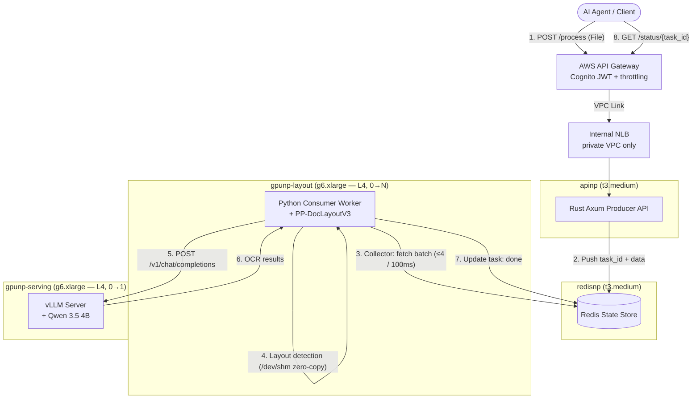

<div align="center">
  <h1>📄 slm-ocr-eks</h1>
  <h3>A production-grade, self-scaling SLM-powered OCR pipeline on AWS EKS</h3>
  <p>Qwen 3.5 (4B) · vLLM · GLM-OCR SDK · Rust (Axum) · Redis · KEDA · Terraform · AWS API Gateway</p>
</div>

---

## What is this?

An event-driven, autoscaling **Visual Document Understanding (VDU)** pipeline on **AWS EKS** — EKS, ECR, AWS API Gateway, Cognito — with all infrastructure managed by **Terraform**, built incrementally over 6 weeks.

This is not a "call an OCR API" demo. It's a two-stage OCR system:

1. **Layout stage (L4 GPU)** — a deterministic layout detector (PP-DocLayoutV3 via the GLM-OCR SDK) segments each document into semantic regions (paragraphs, tables, formulas, charts).
2. **Recognition stage (L4 GPU)** — high-resolution crops are transcribed by **Qwen 3.5 4B** served on **vLLM** with continuous batching, PagedAttention, chunked prefill, and Multi-Token Prediction.

Decoupling layout from generation drastically reduces hallucination on dense tables and noisy scans compared to single-stage end-to-end VLM OCR, and turns one long sequential job per page into many short, batchable requests that keep the GPU saturated.

## Architecture



**KEDA** autoscales every tier independently: the Rust API on CPU, the layout pool on Redis queue depth (scale-on-single-task), and the serving pool on vLLM waiting-requests — GPU tiers from zero.

> **Region note:** ap-southeast-5 (Malaysia) offers only the g6 (L4) GPU family, so both GPU tiers run `g6.xlarge`. The tiers stay architecturally separate — own node groups, taints, and scalers — and instance types are one-line swaps in Terraform.

## AWS building blocks

| Concern | AWS service |
| :--- | :--- |
| Managed Kubernetes | **EKS** (Terraform-managed cluster + managed node groups) |
| Container registry | **ECR** |
| Layout tier | **`g6.xlarge`** node group `gpunp-layout`, tainted `nvidia.com/gpu`, scale-to-zero |
| Serving tier | **`g6.xlarge`** node group `gpunp-serving`, tainted `nvidia.com/gpu`, scale-to-zero |
| Public edge | **AWS API Gateway (HTTP API)** + VPC Link → internal NLB |
| Auth | **Cognito** user pool JWT authorizer |
| Internal load balancing | **AWS Load Balancer Controller**, internal NLB scheme |
| Infrastructure as code | **Terraform** modules (`terraform/`) |

Redis, KEDA, vLLM, the GLM-OCR SDK, and both application services are cloud-agnostic. Design notes in [`docs/aws_services.md`](docs/aws_services.md).

## Build progress (6-week roadmap)

- [x] **Week 0 — Scaffold & AWS setup**: repo structure, Terraform skeleton, quota checks, budget alarms
- [x] **Week 1 — Kubernetes for AI Systems**: VPC + EKS + CPU/GPU (L4) node groups via Terraform, NVIDIA device plugin, taints & tolerations, cross-node-group lab
- [x] **Week 2 — SOTA OCR & VDU**: one-stage vs two-stage OCR trade-offs and the case for layout-first ([journal](docs/journal/week-02.md))
- [ ] **Week 3 — vLLM Inference Engine**: VLM serving on vLLM (chunked prefill, continuous batching), first L4 benchmark
- [ ] **Week 4 — Rust Ingest Gateway**: high-concurrency Axum producer, 10MB limits, atomic Redis writes
- [ ] **Week 5 — Async & Zero-Copy Ingestion**: Python worker with 100ms dynamic batching collector, `/dev/shm` handoff, KEDA scale-to-zero
- [ ] **Week 6 — Enterprise Gateway & MCP**: AWS API Gateway + Cognito JWT + throttling, MCP server for Claude Code, final load test

Each week lands as a PR with its own verification step, plus a learning-log entry in [`docs/journal/`](docs/journal/).

## Repo layout

```
├── docs/               # deployment guide, AWS design notes, weekly journal
├── terraform/
│   ├── modules/        # vpc, eks, nodegroups, ecr, apigw
│   └── envs/dev/       # dev environment composition
├── k8s/eks/            # Kubernetes manifests (apps, infra, networking)
├── services/
│   ├── gateway-rs/     # Rust Axum ingest gateway (Week 4)
│   ├── worker-py/      # Python layout/orchestration worker (Week 5)
│   └── vllm-server/    # vLLM serving container (Week 3)
└── Makefile            # tf-plan / tf-apply / build / deploy shortcuts
```

## ⚠️ Cost safety

This project runs on sponsored AWS credits (MRANTI), and each `g6.xlarge` GPU node costs **≈ $0.80/hour**. Non-negotiable guardrails:

- **Both GPU node groups default to `desired_size = 0`** — they only scale up via KEDA under load or for explicit benchmark sessions.
- **AWS Budgets alarm** on total spend, alerting at 50/80/100% of a monthly cap well below the credit ceiling.
- KEDA cooldowns tuned for fast scale-down (300s) with 10s metric polling.
- Everything is Terraform-managed: the whole environment is destroyed between build sessions and re-applied (~15 min) at the start of the next — $0/day when idle.

## Getting started

See [`docs/eks_deployment.md`](docs/eks_deployment.md) — the provisioning guide grows week by week alongside the build.

## License

Apache 2.0 — see [LICENSE](LICENSE).
