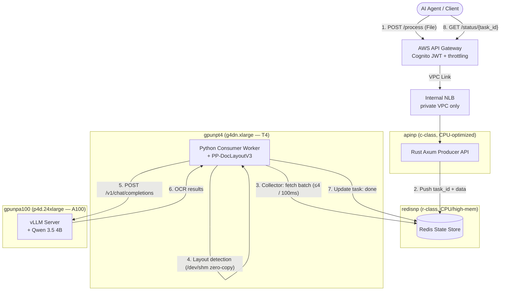

<div align="center">
  <h1>📄 slm-ocr-eks</h1>
  <h3>A production-grade, self-scaling SLM-powered OCR pipeline — ported to AWS EKS</h3>
  <p>Qwen 3.5 (4B) · vLLM · GLM-OCR SDK · Rust (Axum) · Redis · KEDA · Terraform · AWS API Gateway</p>
</div>

---

## What is this?

This repo is my **week-by-week port of a production Visual Document Understanding (VDU) pipeline to AWS EKS**.

The original architecture comes from [The Neural Maze's "Production-Grade SLM-Powered OCR" course](https://theneuralmaze.substack.com/), which targets AKS and GKE. I'm rebuilding it end-to-end on AWS — EKS, ECR, AWS API Gateway, Cognito — with all infrastructure managed by **Terraform**, building it incrementally over 6 weeks as the course progresses.

This is not a "call an OCR API" demo. It's an event-driven, autoscaling, two-stage OCR system:

1. **Layout stage (T4 GPU)** — a deterministic layout detector (PP-DocLayoutV3 via the GLM-OCR SDK) segments each document into semantic regions (paragraphs, tables, formulas, charts).
2. **Recognition stage (A100 GPU)** — high-resolution crops are transcribed by **Qwen 3.5 4B** served on **vLLM** with continuous batching, PagedAttention, chunked prefill, and Multi-Token Prediction.

Decoupling layout from generation drastically reduces hallucination on dense tables and noisy scans compared to single-stage end-to-end VLM OCR.

## Architecture (AWS edition)



**KEDA** autoscales every tier independently: the Rust API on CPU, the T4 layout pool on Redis queue depth (scale-on-single-task), and the A100 inference pool on vLLM waiting-requests — all from zero.

## Azure/GCP → AWS service mapping

| Course (Azure / GCP) | This repo (AWS) |
| :--- | :--- |
| AKS / GKE | **EKS** (Terraform-managed cluster + managed node groups) |
| ACR / Artifact Registry | **ECR** |
| T4 node pool | **`g4dn.xlarge`** node group, tainted `nvidia.com/gpu` |
| A100 node pool | **`p4d.24xlarge`** node group, strict scale-to-zero |
| Azure APIM / GCP API Gateway | **AWS API Gateway (HTTP API)** + VPC Link → internal NLB |
| Entra ID JWT | **Cognito** user pool JWT authorizer |
| Internal Load Balancer annotation | **AWS Load Balancer Controller**, internal NLB scheme |
| `az` / `gcloud` provisioning scripts | **Terraform** modules (`terraform/`) |

Redis, KEDA, vLLM, the GLM-OCR SDK, and both application services are cloud-agnostic and port unchanged. Full details in [`docs/aws_service_mapping.md`](docs/aws_service_mapping.md).

## Build progress (6-week roadmap)

- [x] **Week 0 — Scaffold & AWS setup**: repo structure, Terraform skeleton, quota requests, budget alarms
- [ ] **Week 1 — Kubernetes for AI Systems**: VPC + EKS + CPU/T4/A100 node groups via Terraform, NVIDIA device plugin, taints & tolerations
- [ ] **Week 2 — SOTA OCR & VDU**: single-stage vs two-stage evaluation, GLM-OCR SDK layout detection deep dive
- [ ] **Week 3 — vLLM Inference Engine**: Qwen 3.5 4B on vLLM (MTP, chunked prefill, 262K batched tokens), first A100 benchmark
- [ ] **Week 4 — Rust Ingest Gateway**: high-concurrency Axum producer, 10MB limits, atomic Redis writes
- [ ] **Week 5 — Async & Zero-Copy Ingestion**: Python worker with 100ms dynamic batching collector, `/dev/shm` handoff, KEDA scale-to-zero
- [ ] **Week 6 — Enterprise Gateway & MCP**: AWS API Gateway + Cognito JWT + throttling, MCP server for Claude Code, final load test

Each week lands as a PR with its own verification step, plus a learning-log entry in [`docs/journal/`](docs/journal/).

## Repo layout

```
├── docs/               # deployment guide, AWS mapping, weekly journal
├── terraform/
│   ├── modules/        # vpc, eks, nodegroups, ecr, apigw
│   └── envs/dev/       # dev environment composition
├── k8s/eks/            # Kubernetes manifests (apps, infra, networking)
├── services/
│   ├── gateway-rs/     # Rust Axum ingest gateway (Week 4)
│   ├── worker-py/      # Python layout/orchestration worker (Week 5)
│   └── vllm-server/    # vLLM + Qwen 3.5 container (Week 3)
└── Makefile            # tf-plan / tf-apply / build / deploy shortcuts
```

## ⚠️ Cost safety

This project runs on sponsored AWS credits (MRANTI), and a `p4d.24xlarge` costs **≈ $32/hour**. Non-negotiable guardrails:

- **A100 node group defaults to `desired_size = 0`** — it only scales up via KEDA under load or for explicit benchmark sessions, and is scaled back to zero the same day.
- **AWS Budgets alarm** on total spend, alerting well below the credit ceiling.
- KEDA cooldowns tuned for fast scale-down (300s) with 10s metric polling.
- Everything is Terraform-managed, so `terraform destroy` tears the whole environment down cleanly between working sessions.

## Getting started

See [`docs/eks_deployment.md`](docs/eks_deployment.md) — the provisioning guide grows week by week alongside the build.

## Credits

The pipeline architecture, application services, and course curriculum are by **Miguel Otero Pedrido** ([The Neural Maze](https://theneuralmaze.substack.com/)) and **Antonio Zarauz Moreno**, from their open-source [production OCR course](https://github.com/neural-maze) targeting AKS/GKE. This repo is an independent AWS/EKS port and learning journal built during the course cohort.

## License

Apache 2.0 — see [LICENSE](LICENSE). Matches the upstream course repository's license; ported code retains its original attribution.
